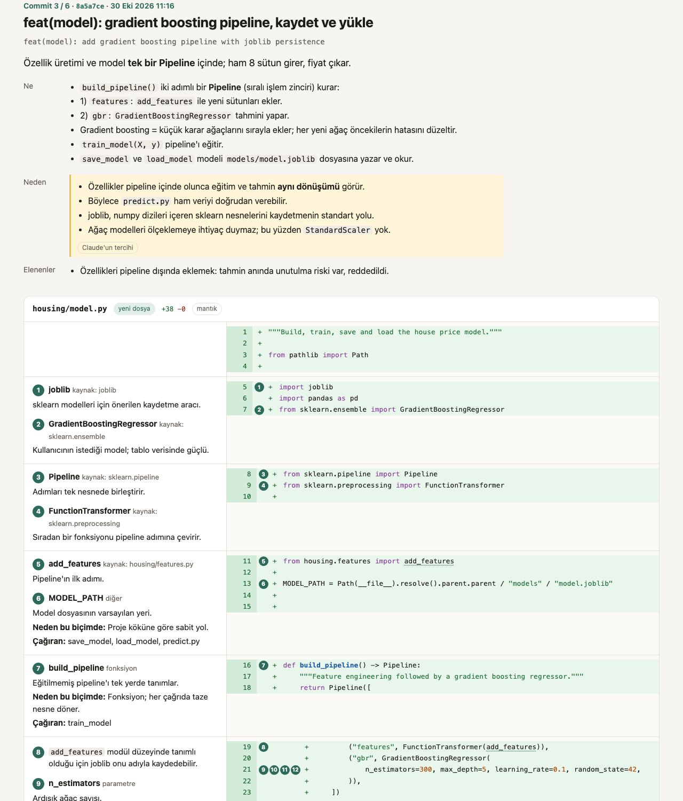

# inloop

Stay in the loop with the code your agent writes.

inloop is a Claude Code plugin. Before each change, Claude explains it in a short, structured
note: the point in one line, what the change does, why, why each new class or function exists,
what it brings in from other files or libraries, and the parameters that matter. You read the
notes live while Claude works, and afterwards in your browser, browsing the code like a repository
with every explanation next to the line it explains. In your language, at the level of detail you
want, and in an ADHD-friendly form if you want.



## What you get

- **Notes while Claude works.** Each note appears in the transcript as a card, right above the
  edit it explains.
- **A review you browse like a repository.** `/inloop review` opens a page in your browser: the
  files of this session's work in a tree, as on GitHub. Each file has three tabs: **Code**, the
  file as it stands with numbered explanations beside the lines they are about; **Changes**, its
  diff in each commit; and **Why**, every block of lines with the commit that last changed it and
  the note that explains that commit. Each commit has its own page too, with its reason first.
- **Line by line.** Comments on the lines a reader would stop at, the class and function cards at
  the line that defines them, and what was imported from elsewhere at the import, with links
  between files. Deleted lines get a comment too: why each one goes and what replaces it.
- **Any commits, any time.** `/inloop review main..` for a branch, `/inloop review HEAD~10..` for
  the last ten commits, `/inloop review a1b2c3d` for one.
- **The code as it stands.** `/inloop explain src/app.py` opens the same page on one file or
  folder, with every explanation inloop has for it.
- **Pull requests.** `/inloop review pr 12` fetches a pull request and opens it the same way.
  `/inloop share pr` writes a comment for your pull request, commit by commit, and shows it to you
  first; `/inloop share pr --yes` posts it, or updates inloop's earlier comment instead of adding
  another.
- **Share it.** `/inloop share` writes the page and a Markdown version to `.inloop/share/` and
  shows them in your file manager, ready to attach to an email. The page opens in any browser,
  offline, and prints to PDF.
- **Code you did not watch being written.** `/inloop:annotate` asks Claude to explain existing
  code, a folder, or a range of commits after the fact, in the same format, marked as explained
  afterwards.
- **Five levels of detail.** From `full` (nearly every line explained, every term defined) through
  `guided`, `essentials` and `design` to `big-picture` (architecture and consequences only). The
  page can switch to a higher level to hide detail.
- **Technical words stay technical.** A note in Turkish says "satırları shuffle edip split eder"
  and "random_state ile reproducible", as Turkish developers do, never a word-for-word translation,
  and explains the terms in a glossary. A note that slips is sent back once to be reworded.
- **In your language.** Notes are written in the language you choose, whatever language you chat
  in. inloop's own labels are in English, Turkish, German and Dutch.
- **ADHD-friendly, on request.** `/inloop adhd on`: the point first, short lines, bold key words,
  and every term, symbol and parameter explained with an example from the code.

## Install

Requires Claude Code 2.1.287 or later.

In Claude Code:

```
/plugin install inloop --marketplace ierolsen/inloop
```

Or from a shell:

```bash
claude plugin marketplace add ierolsen/inloop
claude plugin install inloop@inloop
```

To try it in one session without installing, clone this repository and run
`claude --plugin-dir path/to/inloop/plugins/inloop`.

## Commands

| Command | What it does |
|---|---|
| `/inloop review` | The review of this session: its commits, then what is not committed yet |
| `/inloop review <range>` | Any commits: `main..`, `HEAD~5..`, `a1b2c3d`; `all` for every commit inloop recorded |
| `/inloop review pr [n]` | A pull request, fetched from GitHub with `gh` (the current branch's without a number) |
| `/inloop explain [path]` | The code as it stands, opened on a file or folder, with every explanation inloop has |
| `/inloop share [range]` | The page and its Markdown in `.inloop/share/`, to attach to an email |
| `/inloop share pr [n]` | A preview of a comment for the pull request; add `--yes` to post it |
| `/inloop review ... --theme light` | The page with a fixed theme, to share or print (`dark` also works) |
| `/inloop:annotate <target>` | Claude explains existing code: a file, a folder, a function, a commit range |
| `/inloop lang <language>` | The language of the notes, for all your projects (`--project` for this one) |
| `/inloop level <level>` | How the notes explain: `full`, `guided`, `essentials`, `design` or `big-picture` |
| `/inloop adhd on` | The ADHD-friendly form; `off` to go back |
| `/inloop on`, `/inloop off` | Ask Claude for notes in this session, or stop |
| `/inloop status` | What was recorded, and which settings are in effect |

The language, the level and the ADHD form can also be set in `/config`. A project's own choice
comes first, then yours across projects, then the plugin setting.

On the page, `t` jumps to "Go to file", the level switch hides detail, and "Everything as PDF"
prints every commit (or, for `/inloop explain`, every file) in one go.

## How it works

inloop is a mod: TypeScript that runs inside Claude Code. It adds a short section to Claude's
instructions and gives Claude two tools, `note` and `recap`, which inloop answers itself, so they
never ask for permission. It records every edit Claude makes with its diff, watches `HEAD` after
shell commands to see which commits took which edits, and builds the review from that record and
from git.

Everything stays in your project's `.inloop/` folder, which keeps itself out of git. A session
that changes nothing writes nothing.

## Privacy

inloop's own code makes no network requests and no model calls. The pull request commands run
your own tools: `/inloop review pr` and `/inloop share pr` read the pull request with `gh` and
`git fetch`, and only `/inloop share pr --yes`, typed by you at Claude Code's prompt, posts
anything, as you, with your own `gh` login. The notes are written by Claude in your session, so they cost output tokens;
`/inloop level essentials` or `/inloop off` keep that down. Secrets are redacted before anything is written, and files that usually hold secrets, such
as `.env` files and keys, are recorded by name only. The review page is a single file that loads
nothing from the internet; it holds the code of the files it covers, so share it only with people
who may see that code. See [docs/privacy.md](docs/privacy.md).

## Limits

- Claude Code only. The live cards, the capture and the review rely on Claude Code's plugin
  hooks; other Claude apps load skills only. Organizations can turn plugin mods off.
- Notes depend on Claude following inloop's instructions. Edits made without a note are marked as
  such, and files changed by shell commands are caught through git.
- A review shows up to 30 commits and counts the rest. A page shows the code of up to 40 files,
  of up to 2,000 lines each. A page over 3.8 MB leaves out what it shows twice first, then the
  code of its longest files, and says so.

## Development

See [CLAUDE.md](CLAUDE.md) for the rules and [docs/design.md](docs/design.md) for the design and the
checks behind it. Adding a language is one file: [docs/i18n.md](docs/i18n.md).

```bash
claude plugin test plugins/inloop
claude plugin validate --strict plugins/inloop
```

## License

MIT
